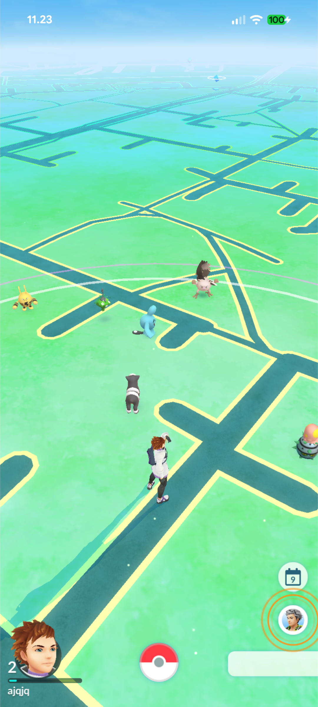
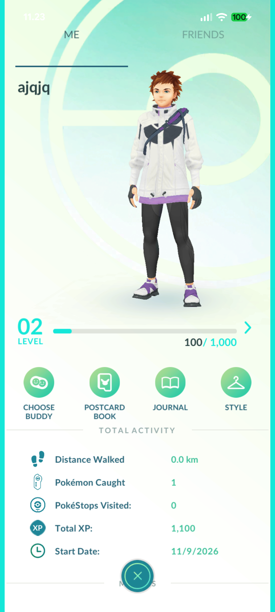
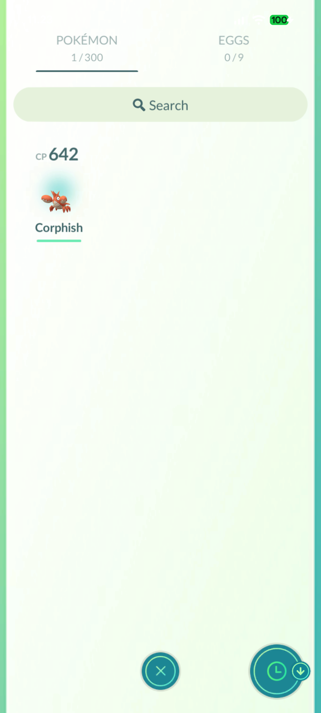
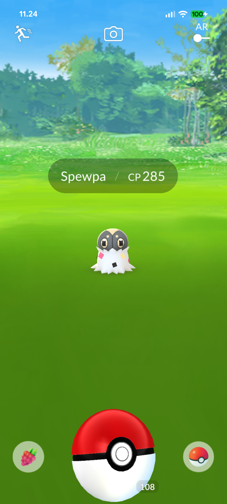
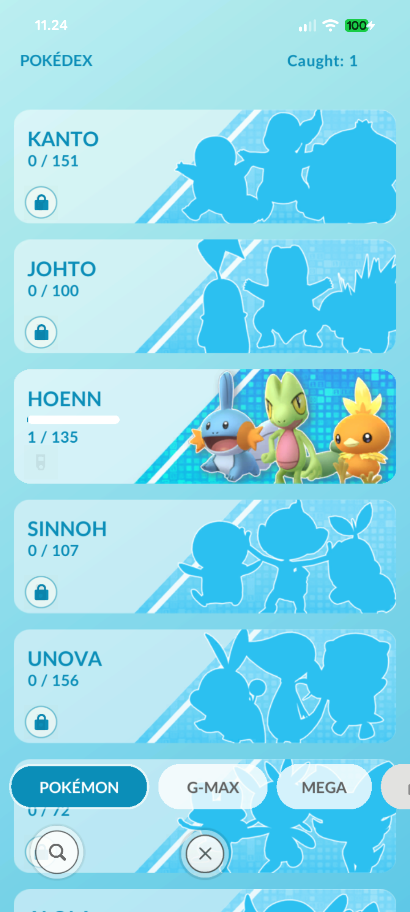
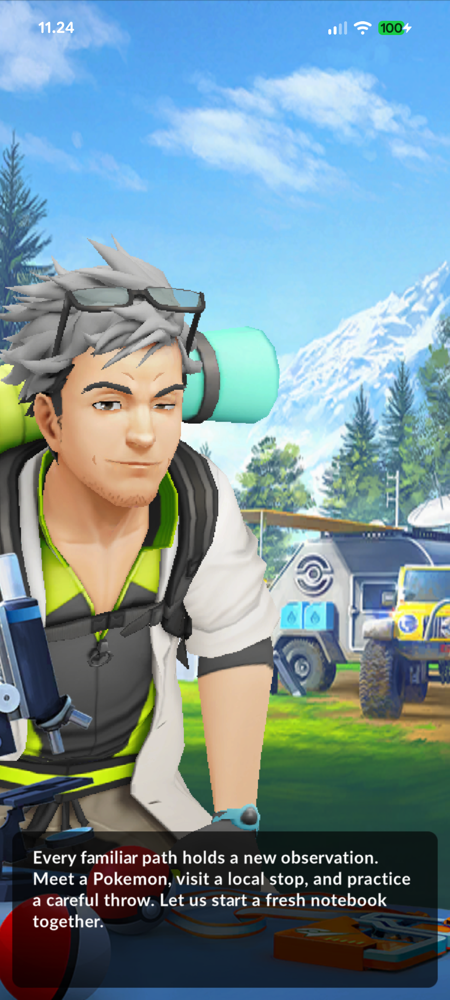

# Dittobuffer

**Dittobuffer is a custom server for Pokemon GO version 0.429.2**
Made with :heart: by `Chucny` and `Gekkedavi`

This tree is organized by component. It contains no game assets, APKs, XAPK
payloads, player data, world snapshots, TLS private keys, or toolchain binaries.

## Screenshots

Fresh-account walkthrough captured in order on the Android build.

<table>
  <tr>
    <td align="center"><br><sub>Map and nearby Pokemon</sub></td>
    <td align="center"><br><sub>New trainer profile</sub></td>
    <td align="center"><br><sub>First catch in storage</sub></td>
  </tr>
  <tr>
    <td align="center"><br><sub>Wild encounter</sub></td>
    <td align="center"><br><sub>Pokedex progress</sub></td>
    <td align="center"><br><sub>Professor Willow intro</sub></td>
  </tr>
</table>

## Layout

```text
server/                 server + phone app + native client source
  src/                  Python game server
  config/               profiles and reference configuration
  protocol/             protobuf definitions and generated modules
  tests/                server tests
  docs/                 server and asset documentation
  scripts/              build, TLS, asset, and maintenance scripts
  android/              Android phone server project
  client/               Frida agent JS and native Rust client source
  data/static/          Game Master binaries and reference tables
  assets/game-master/   Game Master binaries and manifest
platform/               platform/admin service source
game-master/            top-level Game Master copy and notes
docs/screenshots/       screenshots used by this README
app/README.md           Android app entry point
client/README.md        native client/agent entry point
SOURCE-MANIFEST.md      included components and exclusions
SHA256SUMS              checksums for this tree
```

`server/android` is intentionally kept inside the server root. Its
`make_bootstrap.py`, `build.sh`, and packaging scripts expect `src/`,
`config/`, `assets/`, and `client/` as siblings; moving the Android project to
the repository root would break those paths.

## Game Master

Game Master data is explicitly included and is the only permitted game data in
this release:

- `game-master/gmts.binpb.gz`
- `game-master/settings.binpb.gz`
- `game-master/manifest.json`
- `server/assets/game-master/` (same files, in the server's expected location)
- `server/data/static/gmts.binpb.gz`, `settings.binpb.gz`, `manifest.json`
- `server/data/static/max-reference.json`, `pvp-reference.json`

## Android app

The canonical Android project is `server/android/`. See `app/README.md` and
`server/android/README.md`.

Required inputs that are deliberately not shipped:

- Android SDK/JDK/Gradle and the Chaquopy Python 3.10 toolchain.
- The authorized patched client APK (`builds/kit-standalone/dittobuffer-family.apk`).
- The five payload splits.
- The payload/server-bootstrap archives produced from your own authorized
  resources.

The app source includes `app/src/main/java`, `app/src/main/python`,
`app/src/main/res`, the manifest, and the packaging scripts. The
`app/src/main/assets` directory is empty in this source release.

## Server

```bash
cd server
python -m venv .venv
.venv/Scripts/python -m pip install -e . -r requirements.txt   # Windows
# .venv/bin/python -m pip install -e . -r requirements.txt     # Linux/macOS
```

Use `server/config/server.json` for the loopback profile. TLS material is not
included; generate your own with `server/scripts/create-family-tls.py`.

## Platform

```bash
cd platform
python run.py
```

The platform is also available from the top-level launchers:
`start-platform.bat` / `start-platform.sh`. It reads `server/` as its optional
workspace. OSM POI scans use the reachable global
`overpass.openstreetmap.fr` endpoint. The first interactive start asks for a
room name; open <http://127.0.0.1:8780> after launch.

## Deliberately excluded

- Pokémon, Unity, audio, model, texture, bundle, and other game assets.
- APKs, XAPKs, split payloads, patched clients, signing keystores, and build
  metadata.
- TLS certificates/private keys, admin tokens, and saved platform state.
- Player databases, saves, camera/device photos, world snapshots, map
  extracts, and caches.
- Prebuilt Frida gadgets, SDK jars, native `.so` files, and other binaries.
  Supply these from your authorized toolchain.

The small PNGs under `server/android/app/src/main/res` are app UI resources, not
game assets. Game Master data is included as noted above.

## Verification

```bash
sha256sum -c SHA256SUMS
```

## Credits
- `@chucny` - main developer
- `@gekkedavi` - main developer
- `@notmarek` - developer of the LibreNLP plugin that has been used by this project

**Big thanks to:**

- `@djpanther78` - protocol/profobuf defenitions

## Licensing

See the root `LICENSE` (server GPL-3.0-only) and `platform/LICENSE`
(Apache-2.0). Third-party names and resources remain with their owners.
